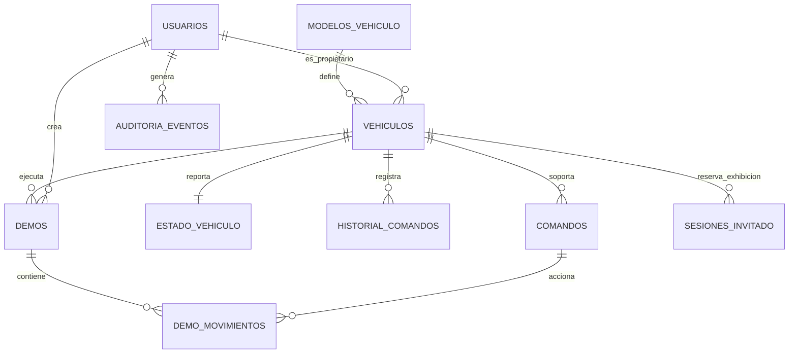

# Plataforma Comercial Multiusuario IoT · Control, Monitoreo y Administración

Sistema web integral y responsivo (*Mobile First* · *Zero-Scroll*) para la comercialización, operación remota, telemetría en tiempo real y administración de vehículos IoT (**Excavadora IoT** y **Rover Explorador 4WD**). Conecta mediante **HTTPS (`Fetch API` con `async/await`)** y **WebSocket Seguro (`WSS`)** con un servidor **Python / FastAPI** en **AWS** y base de datos relacional **Amazon RDS MySQL (`vehiculo_iot`)**.

- **Aplicación en producción (GitHub Pages)**: [https://checojeje.github.io/control_iot/](https://checojeje.github.io/control_iot/)
- **Repositorio Frontend**: [https://github.com/checojeje/control_iot](https://github.com/checojeje/control_iot)
- **Repositorio Backend FastAPI**: [https://github.com/checojeje/api-vehiculo-iot](https://github.com/checojeje/api-vehiculo-iot)
- **Documentación Swagger `/docs`**: [https://api-iot-sergio.duckdns.org/docs](https://api-iot-sergio.duckdns.org/docs)

---

## 1. Módulos Integrados de la Plataforma

1. **Módulo de CONTROL**:
   - **Selector Dinámico de Unidad Activa**: Cambia en caliente la unidad física operada, adaptando los botones táctiles a las capacidades reales de cada modelo y actualizando la suscripción WebSocket.
   - **Joystick Virtual Direccional**: Soporte táctil multipunto (`Pointer Events`), mouse y teclado (`WASD` / Flechas), con telemetría de ángulo, potencia y retorno automático a **Detener**.
   - **Paro de Emergencia Prioritario (`DETENER VEHÍCULO`)** y **Modo Automático (`DEMO`)** con barra de progreso y cancelación instantánea.

2. **Módulo de MONITOREO en Tiempo Real**:
   - **Tarjeta Destacada del Último Movimiento Reportado**: Comando, código real, unidad monitoreada, fecha verificada (`DD/MM/YYYY`), hora local en formato 12h (`HH:MM:SS a. m./p. m.`) y distinción entre persistencia en RDS (`REST`), evento en vivo (`WSS`) y pasos internos de `DEMO`.
   - **Tabla Dinámica de los 10 Movimientos Individuales Más Recientes**: Ordenada del más reciente al más antiguo, deduplicada por `id_historial` y aislada por unidad y propietario.

3. **Módulo de ADMINISTRACIÓN Comercial Multiusuario**:
   - **Dashboard Comercial**: Métricas en vivo de modelos comerciales, unidades físicas, unidades vendidas, unidades en exhibición, clientes compradores y secuencias DEMO.
   - **Inventario de Modelos y Unidades Físicas (CRUD)**: Separación entre **Modelo Comercial** y **Unidad Física** con código de serie único (`EXC-001`, `EXH-002`), estado comercial (`DISPONIBLE`, `VENDIDO`, `EXHIBICION`, `INACTIVO`) y asignación/reasignación de propietario con revocación inmediata.
   - **Clientes Compradores y «Mis Vehículos»**: Alta de compradores y panel para que cada cliente consulte exclusivamente sus unidades y autorice o revoque el permiso de **Soporte Operativo del Administrador**.
   - **Editor Visual de Demos**: Diseñador interactivo para crear, editar, agregar, quitar y reordenar pasos (`▲/▼`) con validación de duración (`300–15000 ms`) y pausa (`0–10000 ms`), persistiendo en Amazon RDS.
   - **Catálogo Público «Prueba Nuestros Vehículos IoT» (Invitados)**: Reserva temporal exclusiva (`180 s`) sobre unidades de exhibición con cuenta regresiva en vivo, bloqueo `HTTP 409 Conflict` ante intentos simultáneos, comandos restringidos y detención segura al finalizar.
   - **Bitácora de Auditoría y Seguridad**: Registro persistente en RDS de inicios de sesión, altas, asignaciones, edición de demos, reservas de invitados y rechazos `401 / 403 / 409`.

---

## 2. Modelo de Roles y Autorización por Recurso (RBAC + BOLA/IDOR)

| Rol Comercial | Cuenta de Prueba | Credenciales | Permisos y Restricciones Verificadas en FastAPI |
| :--- | :--- | :--- | :--- |
| **ADMINISTRADOR** *(Empresa)* | `admin@iot.com` | `Admin123!` | Gestiona Dashboard, modelos, unidades, clientes, asignaciones, demos de fábrica y auditoría. Solo puede enviar comandos a unidades **VENDIDAS** si el comprador tiene activo `soporte_autorizado = 1`. |
| **USUARIO 1** *(Comprador Titular)* | `comprador1@iot.com` | `User123!` | Opera, monitorea y crea demos privadas únicamente sobre sus unidades asignadas (`EXC-001`). Recibe `403 Forbidden` si intenta consultar u operar unidades ajenas o entrar al Dashboard administrativo. |
| **USUARIO 2** *(Comprador 2)* | `comprador2@iot.com` | `User123!` | Cuenta para validación de aislamiento BOLA/IDOR: recibe `403 Forbidden` al intentar consultar o mover la unidad `EXC-001` de `comprador1@iot.com`. |
| **INVITADO** *(Prospecto)* | Acceso público / Reserva temporal | Sin contraseña permanente | Explora el catálogo de exhibición y solicita una sesión temporal exclusiva (`180 s`) sobre unidades en estado `EXHIBICION` (`EXH-002`). Recibe `403 Forbidden` en unidades vendidas, comandos avanzados o rutas administrativas. |

---

## 3. Diagrama Entidad-Relación (`vehiculo_iot`)



---

## 4. Estructura Modular del Proyecto

```text
├── index.html                  # Interfaz integrada con pestañas CONTROL | MONITOREO | ADMINISTRACIÓN
├── README.md                   # Documentación técnica integral del sistema
└── assets/
    ├── favicon.svg             # Icono vectorial del sistema
    ├── css/
    │   └── style.css           # Diseño Industrial Cockpit (100dvh Zero-Scroll responsivo)
    └── js/
        ├── app.js              # Orquestador general: navegación, cambio de unidad y sesión WSS
        ├── api.js              # Cliente HTTP Fetch (Bearer token, X-Session-Role y rutas REST)
        ├── ws.js               # Cliente WebSocket compartido con cambio dinámico de unidad
        ├── admin.js            # Módulo de Administración, Roles, CRUD, Editor de Demos y Auditoría
        ├── monitoring.js       # Tarjeta de último movimiento, tabla de 10 registros y reconciliación
        ├── datetime.js         # Conversión de marcas temporales UTC de Amazon RDS a hora local 12h
        ├── joystick.js         # Controlador del joystick virtual (Pointer Events + teclado)
        └── ui.js               # Renderizado de controles táctiles, pestañas, alertas e indicadores
```

---

**Desarrollado por Jesús Sergio Quiroz Guzmán · 2026**
