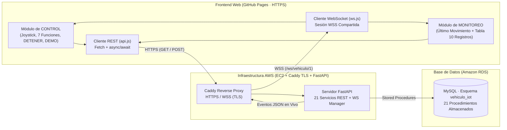

# Excavadora IoT · Plataforma Web de Control y Monitoreo en Tiempo Real

Aplicación web progresiva y responsiva (*Mobile First* · *Zero-Scroll*) para la operación remota y el monitoreo en tiempo real del vehículo **Excavadora IoT (ID #1)**. Se integra mediante **HTTPS (`Fetch API` con `async/await`)** y **WebSocket Seguro (`WSS`)** con un backend **Python / FastAPI** desplegado en **AWS** y respaldado por **Amazon RDS MySQL (`vehiculo_iot`)**.

- **Aplicación en producción (GitHub Pages)**: [https://checojeje.github.io/control_iot/](https://checojeje.github.io/control_iot/)
- **Repositorio oficial**: [https://github.com/checojeje/control_iot](https://github.com/checojeje/control_iot)

---

## 1. Descripción General de la Plataforma

El sistema integra en una sola interfaz de cabina industrial dos módulos complementarios que comparten estado, configuración y una única sesión WebSocket en tiempo real:

1. **Módulo de CONTROL**:
   - **Joystick Virtual Direccional**: Soporte táctil multipunto (`Pointer Events`), mouse y teclado (`WASD` / Flechas), con cálculo trigonométrico en tiempo real de ángulo (`0°–360°`), potencia (`0%–100%`) y dirección activa, más retorno automático al centro (**Detener**).
   - **Panel de Funciones del Vehículo**: Controles táctiles dedicados para el giro de cabina, brazo hidráulico (garra), iluminación, alerta acústica y niveles de velocidad.
   - **Paro de Emergencia Prioritario (`DETENER VEHÍCULO`)**: Botón de prioridad operativa que cancela cualquier secuencia automática en curso, centra el joystick y envía inmediatamente el comando `Detener`.
   - **Modo Automático (`DEMO`)**: Consulta y ejecución de secuencias programadas en la base de datos respetando tiempos de duración y pausa por paso, con barra de progreso en vivo y cancelación inmediata.

2. **Módulo de MONITOREO en Tiempo Real**:
   - **Tarjeta Destacada del Último Movimiento Reportado**: Visualización en vivo del último comando o estado del vehículo con icono dinámico, código de operación, nombre del vehículo, **fecha verificada (`DD/MM/YYYY`)**, **hora exacta en zona horaria local (`HH:MM:SS a. m./p. m.`)** y distinción clara del origen del dato (*Persistido en RDS vía REST*, *Evento en vivo vía WSS* o *Paso interno de DEMO*).
   - **Tabla Dinámica de los 10 Movimientos Individuales Más Recientes**: Consulta sincronizada con Amazon RDS que presenta los últimos diez movimientos individuales ordenados del más reciente al más antiguo (`#`, `Movimiento`, `Origen`, `Fecha` y `Hora`), con deduplicación por `id_historial` y filtrado por vehículo.
   - **Aislamiento de Secuencias DEMO**: Durante la ejecución de una secuencia automática, los pasos internos (`MOVIMIENTO_DEMO`) actualizan la tarjeta de estado en tiempo real sin contaminar la tabla de historial de movimientos individuales.

3. ** Diagnóstico Independiente de Infraestructura (3 Indicadores en Tiempo Real)**:
   - **WebSocket WSS**: Estado real de la sesión del navegador (`En línea`, `Conectando`, `Reconectando`, `Desconectado`) con *heartbeat* (`PING`) y reconexión automática progresiva.
   - **API AWS · 21 servicios**: Verificación de disponibilidad del servidor FastAPI en AWS (`Disponible`, `Comprobando`, `No disponible`).
   - **Amazon RDS**: Verificación de conectividad con la base de datos MySQL mediante diagnóstico real del estado del vehículo (`Disponible`, `No disponible`, `Sin verificar`).

---

## 2. Arquitectura del Sistema



---

## 3. Estructura del Proyecto

```text
├── index.html                  # Documento principal HTML5 semántico (Vistas CONTROL y MONITOREO)
├── README.md                   # Documentación técnica integral del sistema
└── assets/
    ├── favicon.svg             # Icono vectorial del sistema
    ├── css/
    │   └── style.css           # Sistema de diseño Industrial Cockpit (100dvh Zero-Scroll responsivo)
    └── js/
        ├── app.js              # Orquestador general: navegación, ciclo de vida, eventos y estado global
        ├── api.js              # Cliente HTTP Fetch (timeouts, cola secuencial y rutas REST de AWS)
        ├── ws.js               # Cliente WebSocket nativo con reconexión progresiva y heartbeat
        ├── monitoring.js       # Motor de monitoreo: tarjeta de último estado, tabla de 10 filas y reconciliación
        ├── datetime.js         # Conversión de marcas temporales UTC de Amazon RDS a hora local y formato 12h
        ├── joystick.js         # Controlador del joystick virtual (Pointer Events + teclado + telemetría)
        └── ui.js               # Renderizado de controles táctiles, pestañas, alertas e indicadores
```

---

## 4. Catálogo de Comandos del Vehículo (`Excavadora IoT · ID #1`)

El sistema consume dinámicamente el catálogo almacenado en Amazon RDS (`GET /api/vehiculos/1/comandos`), distribuyendo las 13 operaciones reales de la siguiente manera:

| ID / Código | Nombre del Comando | Componente de Interfaz | Categoría Operativa |
| :---: | :--- | :--- | :--- |
| `1` | **Avanzar** | Joystick (Arriba `▲` / `W` / `↑`) | Tracción principal |
| `2` | **Retroceder** | Joystick (Abajo `▼` / `S` / `↓`) | Tracción principal |
| `3` | **Cabina Izquierda** | Botón de función táctil | Giro de torreta |
| `4` | **Cabina Derecha** | Botón de función táctil | Giro de torreta |
| `5` | **Girar Derecha** | Joystick (Derecha `►` / `D` / `→`) | Dirección principal |
| `6` | **Girar Izquierda** | Joystick (Izquierda `◄` / `A` / `←`) | Dirección principal |
| `7` | **Bajar Garra** | Botón de función táctil | Brazo hidráulico |
| `8` | **Subir Garra** | Botón de función táctil | Brazo hidráulico |
| `9` | **Luz** | Botón de función táctil | Sistema óptico |
| `10` | **Sonido** | Botón de función táctil | Alerta acústica |
| `11` | **Velocidad** | Botón de función táctil | Potencia de motor |
| `12` | **Demo** | Selector y ejecutor de secuencias DEMO | Automatización |
| `13` | **Detener** | Centro de Joystick + Botón Prioritario `DETENER VEHÍCULO` | Paro de seguridad |

---

## 5. Integración con Servicios REST y WebSocket en AWS

### Configuración de Endpoints
- **URL Base REST (HTTPS)**: `https://api-iot-sergio.duckdns.org`
- **Endpoint WebSocket (WSS)**: `wss://api-iot-sergio.duckdns.org/ws/vehiculo/1`
- **Identificador de Vehículo**: `1` (`Excavadora IoT`)

### Rutas REST Consumidas

| Servicio | Método y Ruta | Procedimiento Almacenado | Propósito en la Aplicación |
| :--- | :--- | :--- | :--- |
| Salud de la API | `GET /openapi.json` | N/A (Metadatos FastAPI) | Validar disponibilidad del servidor de 21 APIs en AWS |
| Información de Vehículo | `GET /api/vehiculos/1` | `sp_obtener_vehiculo(1)` | Obtener nombre y metadatos del vehículo activo |
| Catálogo de Comandos | `GET /api/vehiculos/1/comandos` | `sp_obtener_comandos_vehiculo(1)` | Sincronizar IDs y nombres reales de los 13 comandos |
| Estado Actual y Salud RDS | `GET /api/vehiculos/1/estado` | `sp_obtener_estado(1)` | Confirmar disponibilidad de RDS y consultar el último movimiento |
| Historial de Movimientos | `GET /api/vehiculos/1/historial` | `sp_obtener_historial(1)` | Recuperar los últimos 10 movimientos individuales persistidos |
| Despacho de Movimiento | `POST /api/vehiculos/movimiento` | `sp_actualizar_estado` + `sp_registrar_historial` | Registrar movimiento individual y emitir evento `NUEVO_MOVIMIENTO` |
| Catálogo de DEMO | `GET /api/vehiculos/1/demos` | `sp_obtener_demos(1)` | Listar las secuencias automáticas configuradas para el vehículo |
| Pasos de una DEMO | `GET /api/demos/{id}/movimientos` | `sp_obtener_movimientos_demo(id)` | Consultar orden, duración (`duracion_ms`) y pausa (`pausa_ms`) |
| Ejecución de DEMO | `POST /api/vehiculos/demo` | `sp_obtener_movimientos_demo` + `sp_actualizar_estado` | Ejecutar secuencia automática y transmitir pasos por WebSocket |

### Eventos del Canal WebSocket (`WSS`)

1. **`CONEXION_ESTABLECIDA`**:
   ```json
   {
     "evento": "CONEXION_ESTABLECIDA",
     "vehiculo_id": 1,
     "mensaje": "Monitoreo en tiempo real iniciado"
   }
   ```
2. **`NUEVO_MOVIMIENTO`** *(dispara actualización inmediata del último movimiento y reconciliación REST de la tabla de 10 registros)*:
   ```json
   {
     "evento": "NUEVO_MOVIMIENTO",
     "vehiculo_id": 1,
     "comando_id": 1
   }
   ```
3. **`INICIO_DEMO` / `MOVIMIENTO_DEMO` / `FIN_DEMO`** *(actualizan el último estado reportado en vivo sin agregarse a la tabla de historial individual)*:
   ```json
   {
     "evento": "MOVIMIENTO_DEMO",
     "orden": 1,
     "comando_id": 1,
     "duracion_ms": 2000
   }
   ```

---

## 6. Características Técnicas Destacadas

- **Diseño Responsivo *Zero-Scroll* (`100dvh`)**: Adaptación automática sin barras de desplazamiento en monitores de escritorio, teléfonos en orientación vertical (*Portrait*) y teléfonos en orientación horizontal (*Landscape*).
- **Cola Secuencial de Movimientos**: Garantiza que al mover y soltar rápidamente el joystick, el comando `Detener` (`ID #13`) se envíe siempre en orden estricto después del comando direccional sin abortar peticiones en vuelo.
- **Control de Concurrencia y Deduplicación en Monitoreo**: Uso de identificadores de secuencia (`syncSequenceId`), validación de marcas temporales y filtrado por `id_historial` para impedir filas duplicadas o que respuestas HTTP tardías sobrescriban eventos WSS más recientes.
- **Conversión Automática de Zona Horaria**: Transformación exacta de marcas temporales UTC provenientes de Amazon RDS al huso horario local del navegador en formato de 12 horas (`DD/MM/YYYY` y `HH:MM:SS a. m./p. m.`).
- **Resiliencia ante Cambios de Red**: Reconexión automática ante eventos `online` y `visibilitychange` en dispositivos móviles, seguida de resincronización completa de estado e historial.

---

## 7. Ejecución Local y Despliegue

### Ejecución en Entorno Local
Dado que el proyecto utiliza **módulos nativos ES6 (`<script type="module">`)**, debe abrirse mediante un servidor HTTP local (no desde `file://`):

1. Clonar el repositorio:
   ```bash
   git clone https://github.com/checojeje/control_iot.git
   cd control_iot
   ```
2. Iniciar con **Live Server** en Visual Studio Code o con Python:
   ```bash
   python -m http.server 5500
   ```
3. Abrir en el navegador: `http://127.0.0.1:5500`

### Publicación en GitHub Pages
Todas las rutas de estilos (`./assets/css/style.css`), módulos (`./assets/js/...`) e iconos (`./assets/favicon.svg`) son relativas, lo que permite su publicación directa desde la rama `main` en la subruta `/control_iot/` de GitHub Pages bajo HTTPS.

---

**Desarrollado por Jesús Sergio Quiroz Guzmán · 2026**
