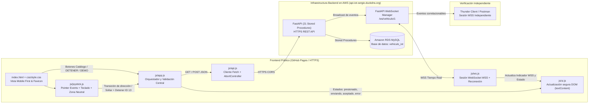

# Aplicación Web de Control IoT — Excavadora IoT (Vehículo #1)

Aplicación web frontend **Mobile First**, modular y segura construida con **HTML5 semántico**, **CSS3**, **Bootstrap 5** y **JavaScript ES6 Modules**, diseñada exclusivamente para el **Módulo de Control** del vehículo **Excavadora IoT (`vehiculo_id: 1`)** conectado a la infraestructura en **AWS** (`FastAPI` + `WebSocket WSS` + `Amazon RDS MySQL`).

---

## 1. Mapa de Arquitectura y Flujo de Datos



### Relación entre Módulos
1. **`index.html`**: Estructura semántica HTML5, referencia al favicon relativo (`./assets/favicon.svg`), panel de 3 indicadores, contenedor del joystick circular, botón prioritario **DETENER (ID: 13)**, botones secundarios del catálogo, selector de ejecución DEMO y footer obligatorio con los créditos del autor.
2. **`css/style.css`**: Estilos Mobile First, joystick circular responsivo (`aspect-ratio: 1 / 1`, `touch-action: none`), áreas táctiles mínimas de `44px`, foco visible (`:focus-visible`) y clases para los 6 estados de botones (`normal`, `presionado`, `enviando`, `aceptado`, `error`, `deshabilitado`).
3. **`js/ui.js`**: Manipulación pura y segura del DOM mediante `textContent` y `createElement` (previene XSS). Controla los colores, iconos y etiquetas exactas de los 3 indicadores de conectividad.
4. **`js/api.js`**: Cliente HTTP basado en `fetch` y `async/await` con `AbortController`. Centraliza URLs, timeouts y cancela peticiones en vuelo si el usuario cambia rápidamente de dirección o presiona **DETENER**.
5. **`js/ws.js`**: Cliente nativo `WebSocket` (`wss://`) con reconexión exponencial y *heartbeat*. Actualiza el indicador **WebSocket WSS** (`En línea`, `Conectando-Reconectando`, `Desconectado`) y procesa `CONEXION_ESTABLECIDA`, `NUEVO_MOVIMIENTO`, `INICIO_DEMO`, `MOVIMIENTO_DEMO` y `FIN_DEMO`.
6. **`js/joystick.js`**: Lógica de *Pointer Events* (`pointerdown`, `pointermove`, `pointerup`, `pointercancel`, `lostpointercapture`), soporte de teclado y detección de pérdida de foco (`blur`, `visibilitychange`). Mapea ángulos a los comandos direccionales válidos (`1, 2, 5, 6`), evita POST repetitivos por píxel y garantiza retorno automático al centro disparando `Detener` (`id_comando: 13`).
7. **`js/app.js`**: Orquestador principal que une vista, validación de dominio, servicio único de envío de comandos, bloqueo de controles durante una DEMO y verificación periódica de salud.

---

## 2. Árbol de Carpetas y Archivos

```text
control_iot/
├── assets/
│   └── favicon.svg        # Favicon vectorial propio del proyecto IoT
├── css/
│   └── style.css          # Estilos Mobile First, Joystick circular y estados de botones
├── js/
│   ├── api.js             # Cliente Fetch REST con AbortController y diagnósticos de salud
│   ├── app.js             # Orquestador principal y servicio único de despacho de comandos
│   ├── joystick.js        # Controlador Pointer Events + Teclado + Catálogo de 13 comandos
│   ├── ui.js              # Actualizadores seguros del DOM y de los 3 indicadores
│   └── ws.js              # Cliente WebSocket WSS con reconexión automática
├── index.html             # Interfaz principal de Control IoT
└── README.md              # Documentación técnica, arquitectura y guía de pruebas
```

---

## 3. Configuración de URL Base, Endpoints y Catálogo Real (Sin Secretos)

- **URL Base HTTPS (`API_BASE_URL`)**: `https://api-iot-sergio.duckdns.org`
- **URL WebSocket (`WS_URL`)**: `wss://api-iot-sergio.duckdns.org/ws/vehiculo/1`
- **Documentación Swagger / OpenAPI**: `https://api-iot-sergio.duckdns.org/docs` (`/openapi.json`)
- **Identificador del Vehículo (`VEHICLE_ID`)**: `1` (`Excavadora IoT`)

### Endpoints Consumidos por la Aplicación de Control

| Operación | Método y Ruta | Cuerpo JSON (Solicitud) | Respuesta Real Esperada |
| :--- | :--- | :--- | :--- |
| **Salud Servidor AWS (21 APIs)** | `GET /openapi.json` | N/A | Esquema JSON OpenAPI 3.x con las rutas del servidor |
| **Diagnóstico Seguro Amazon RDS** | `GET /api/vehiculos/1/estado` | N/A | `{"id_vehiculo":1,"vehiculo":"Excavadora IoT","id_comando":13,"comando":"Detener","codigo":13,"conectado":1,"fecha_actualizacion":"..."}` |
| **Obtener Catálogo de Comandos** | `GET /api/vehiculos/1/comandos` | N/A | `{"vehiculo_id":1,"total":13,"comandos":[...]}` |
| **Enviar Movimiento / Acción** | `POST /api/vehiculos/movimiento` | `{"vehiculo_id":1,"comando_id":1,"origen":"WEB_JOYSTICK"}` | `{"status":"success","message":"Estado actualizado e historial registrado correctamente."}` |
| **Obtener Secuencias DEMO** | `GET /api/vehiculos/1/demos` | N/A | `{"vehiculo_id":1,"total":1,"demos":[{"id_demo":1,"id_vehiculo":1,"nombre":"Demo principal",...}]}` |
| **Iniciar Secuencia DEMO** | `POST /api/vehiculos/demo` | `{"vehiculo_id":1,"demo_id":1}` | `{"status":"success","message":"DEMO 1 ejecutada y transmitida correctamente."}` |
| **Cancelar DEMO / Forzar Detener** | `POST /api/vehiculos/estado/actualizar` | `{"id_vehiculo":1,"id_comando":13,"conectado":true}` | `{"status":"success","procedimiento":"sp_actualizar_estado",...}` |

### Catálogo Real de 13 Comandos (`vehiculo_id: 1`)

| `id_comando` | `codigo` | `nombre` | `descripcion` | Componente UI Asignado |
| :---: | :---: | :--- | :--- | :--- |
| **`1`** | `1` | `Avanzar` | Mover adelante | Joystick Arriba (45° – 135°) |
| **`2`** | `2` | `Retroceder` | Mover hacia atrás | Joystick Abajo (225° – 315°) |
| **`3`** | `3` | `Cabina Izquierda` | Girar cabina a la izquierda | Botón secundario |
| **`4`** | `4` | `Cabina Derecha` | Girar cabina a la derecha | Botón secundario |
| **`5`** | `5` | `Girar Derecha` | Giro hacia la derecha | Joystick Derecha (315° – 45°) |
| **`6`** | `6` | `Girar Izquierda` | Giro hacia la izquierda | Joystick Izquierda (135° – 225°) |
| **`7`** | `7` | `Bajar Garra` | Bajar la garra | Botón secundario |
| **`8`** | `8` | `Subir Garra` | Subir la garra | Botón secundario |
| **`9`** | `9` | `Luz` | Encender o apagar luz | Botón secundario |
| **`10`** | `10` | `Sonido` | Activar sonido | Botón secundario |
| **`11`** | `11` | `Velocidad` | Ajustar velocidad del vehículo | Botón secundario |
| **`12`** | `12` | `Demo` | Iniciar secuencia de demostración | Ejecución DEMO |
| **`13`** | `13` | `Detener` | Detener cualquier movimiento | Zona neutral Joystick + Botón Prioritario DETENER |

---

## 4. Instrucciones para Ejecución Local

> **Importante**: Dado que la aplicación utiliza módulos nativos ES6 (`<script type="module">`), **no debe abrirse haciendo doble clic sobre `index.html` (`file://`)**, ya que los navegadores bloquean las importaciones de módulos por políticas CORS sobre `file://`.

1. Abre la carpeta `control_iot` en **Visual Studio Code**.
2. Haz clic derecho sobre `index.html` y selecciona **"Open with Live Server"** (se abrirá en `http://127.0.0.1:5500`).
   - *Alternativa con Python*:
     ```bash
     python -m http.server 5500
     ```
3. Si utilizas el navegador **Brave**, desactiva **Brave Shields** (ícono del león en la barra de direcciones) para `127.0.0.1:5500` o `github.io`, ya que las listas por defecto de Brave filtran subdominios `*.duckdns.org`.

---

## 5. Guía de Publicación en GitHub Pages y Commits Recomendados

Todas las rutas del proyecto (`./css/style.css`, `./js/app.js`, `./assets/favicon.svg`) son relativas, por lo que funcionan directamente en cualquier subruta `https://<usuario>.github.io/<repositorio>/`.

### Pasos para publicar:
1. Inicializa el repositorio dentro de `control_iot`:
   ```bash
   git init
   git branch -M main
   ```
2. Realiza commits atómicos recomendados:
   ```bash
   git add index.html assets/favicon.svg
   git commit -m "feat(ui): agregar estructura HTML5 semantica, panel de 3 indicadores y favicon"

   git add css/style.css
   git commit -m "style(joystick): implementar estilos Mobile First, joystick circular y estados de botones"

   git add js/ui.js js/api.js
   git commit -m "feat(api): implementar cliente Fetch con AbortController y actualizadores seguros de UI"

   git add js/ws.js js/joystick.js js/app.js
   git commit -m "feat(control): integrar WebSocket WSS, Pointer Events de joystick y orquestador principal"

   git add README.md
   git commit -m "docs(readme): documentar arquitectura, contratos AWS, casos de prueba y guia GitHub Pages"
   ```
3. Vincula tu repositorio remoto en GitHub y sube los cambios:
   ```bash
   git remote add origin https://github.com/<tu-usuario>/<tu-repositorio>.git
   git push -u origin main
   ```
4. En GitHub, entra a **Settings → Pages → Build and deployment**:
   - **Source**: `Deploy from a branch`
   - **Branch**: `main` / `/ (root)` y presiona **Save**.
5. En 1–2 minutos tu aplicación estará publicada bajo HTTPS en `https://<tu-usuario>.github.io/<tu-repositorio>/`.

---

## 6. Casos de Prueba Paso a Paso y Verificación Independiente WebSocket

### A. Verificación Independiente en Thunder Client / Postman
1. Abre **Thunder Client** (o Postman) y crea una petición **WebSocket** hacia:
   ```text
   wss://api-iot-sergio.duckdns.org/ws/vehiculo/1
   ```
2. Haz clic en **Connect**. Observarás el evento inicial:
   ```json
   {"evento":"CONEXION_ESTABLECIDA","vehiculo_id":1,"mensaje":"Monitoreo en tiempo real iniciado"}
   ```
3. Mantén abierta esa ventana de Thunder Client mientras realizas las pruebas siguientes desde la aplicación web.

### B. Prueba de Joystick (Táctil, Mouse y Teclado)
1. Arrastra la perilla hacia **Arriba**:
   - Se envía **un único** `POST /api/vehiculos/movimiento` con `comando_id: 1` (`Avanzar`). No se disparan peticiones repetitivas por cada píxel recorrido.
   - En Thunder Client aparece inmediatamente: `{"evento":"NUEVO_MOVIMIENTO","vehiculo_id":1,"comando_id":1}`.
2. Sin soltar, gira hacia la **Derecha** (`comando_id: 5`), **Abajo** (`comando_id: 2`) e **Izquierda** (`comando_id: 6`):
   - En cada transición de cuadrante se envía el comando correspondiente.
3. Suelta la perilla (o cambia de pestaña):
   - La perilla regresa automáticamente al centro (`Neutral`) y dispara con prioridad absoluta `Detener` (`comando_id: 13`).
   - En Thunder Client se recibe: `{"evento":"NUEVO_MOVIMIENTO","vehiculo_id":1,"comando_id":13}`.

### C. Prueba de Controles Secundarios y Estados de Botón
1. Presiona cualquiera de los 7 botones secundarios (`Cabina Izquierda` ID 3, `Cabina Derecha` ID 4, `Bajar Garra` ID 7, `Subir Garra` ID 8, `Luz` ID 9, `Sonido` ID 10, `Velocidad` ID 11).
2. Observa las transiciones visuales del botón: **Presionado → Enviando (borde ámbar) → Aceptado (borde verde) → Normal**, y la confirmación correlacionada en Thunder Client.

### D. Prueba de Botón Prioritario DETENER (ID: 13)
1. En cualquier momento presiona el botón rojo **DETENER VEHÍCULO (ID: 13)**.
2. Cualquier petición en vuelo se cancela mediante `AbortController`, el joystick vuelve al centro y se registra `{"evento":"NUEVO_MOVIMIENTO","vehiculo_id":1,"comando_id":13}`.

### E. Prueba de Secuencia DEMO y Cancelación
1. Selecciona `Demo principal` en el selector y pulsa **Iniciar DEMO**.
2. Los botones secundarios y el joystick quedan temporalmente deshabilitados para impedir comandos incompatibles simultáneos.
3. En Thunder Client observarás en tiempo real y con la temporización del servidor:
   - `{"evento":"INICIO_DEMO","demo_id":1,"total_movimientos":...}`
   - N eventos `{"evento":"MOVIMIENTO_DEMO","orden":...,"comando_id":...,"duracion_ms":...}`
   - `{"evento":"FIN_DEMO","demo_id":1}`
4. Si durante la ejecución presionas **Cancelar / Detener** (o el botón rojo **DETENER**), la espera se aborta y se envía de inmediato `Detener` (`id_comando: 13`).

---

## 7. Checklist de Seguridad, Accesibilidad y Resiliencia

- [x] **Cero Secretos Públicos**: Ninguna contraseña, token AWS ni credencial de MySQL/RDS está incrustada en el código frontend.
- [x] **Prevención de Mixed Content**: Todas las llamadas desde GitHub Pages (`https://`) utilizan exclusivamente `https://api-iot-sergio.duckdns.org` y `wss://api-iot-sergio.duckdns.org/ws/vehiculo/1`.
- [x] **Prevención de XSS / Inyección DOM**: Las respuestas JSON remotas se insertan únicamente con `textContent` y nodos seguros, nunca concatenando HTML sin sanitizar.
- [x] **Tres Indicadores Diferenciados**:
  - **WebSocket WSS**: `En línea` / `Conectando-Reconectando` / `Desconectado`
  - **Servidor AWS (21 APIs)**: `Disponible` / `Comprobando` / `No disponible`
  - **Amazon RDS**: `Disponible` / `No disponible` / `Sin verificar`
- [x] **Diferenciación Semántica**: Se aclara explícitamente en la interfaz que la sesión WSS del navegador no implica que el microcontrolador físico ESP8266/ESP32 esté encendido o ejecutando motores.
- [x] **Accesibilidad y Diseño Móvil**: Áreas táctiles mínimas de `44px`, contraste elevado, atributos `aria-live`, control del joystick por teclado (`Flechas` y `Espacio`/`Escape`), favicon SVG vinculado y footer responsivo con los créditos obligatorios: `Desarrollado por Jesús Sergio Quiroz Guzmán · 2026`.
